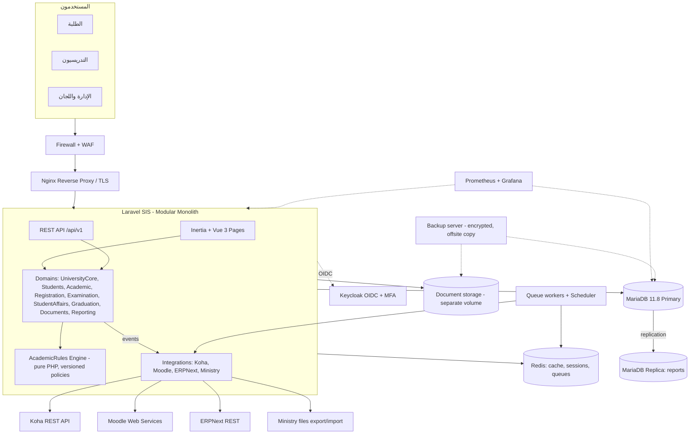

# Architecture Decision Records — Iraqi University SIS

التاريخ: 2026-11-18. الصيغة: السياق، القرار، البدائل، العواقب. عند التنفيذ يُقسم هذا الملف إلى `docs/adr/NNNN-title.md`.

## المخطط المعماري الأولي

---

## ADR-001: Laravel ببنية FileNest بدلاً من Frappe
- **الحالة:** معتمد (2026-11-18، قرار المالك).
- **السياق:** البرومبت يقترح Frappe + Education. المالك طلب أن تكون البنية مطابقة لـ FileNest (Laravel 13، Inertia v2، Vue 3، MySQL/MariaDB، Docker، GitHub Actions). الفريق يشغّل حالياً 4 مستودعات Laravel. لا تغطي أي منصة جاهزة قواعد بولونيا والنظام التقليدي العراقي، لذا الجزء الحرج تطوير مخصص في كل الحالات.
- **القرار:** Laravel 13.x على PHP 8.4، Inertia v2 + Vue 3 + Tailwind، بنفس تنظيم مجلدات FileNest.
- **البدائل:** Frappe Education v16 (هيكل جاهز، لكن نموذج DocType يقيّد المحرك وخبرة الفريق غير معروفة)؛ OpenEduCat Community (GPA وgradebook في النسخة المدفوعة فقط، ويفرض PostgreSQL).
- **العواقب:** بناء الشاشات الإدارية من الصفر (لا Desk جاهز). إعادة استخدام المصادقة و2FA والتعريب وعميل Koha وDocker وCI من FileNest. ترقية Laravel 13 إلى 14 قبل مارس 2028 (نهاية أمان 13).

## ADR-002: Modular Monolith
- **القرار:** تطبيق واحد، نطاقات في `app/Domains/*`، كل نطاق يملك Models وActions وPolicies وEvents وJobs. لا كتابة عبر حدود النطاقات. يُفرض باختبار بنية في CI.
- **البدائل:** Microservices (تعقيد تشغيل غير مبرر لفريق صغير ولـ 25,000 طالب).
- **العواقب:** نشر واحد، معاملات قاعدة بيانات واحدة، فصل مستقبلي ممكن عبر حدود النطاقات والأحداث.

## ADR-003: MariaDB 11.8 LTS مع Replica
- **القرار:** MariaDB 11.8 LTS (دعم المجتمع حتى 2028-06-04) Primary + Replica للقراءة والتقارير. utf8mb4، المنطقة الزمنية +03:00 كما في FileNest.
- **البدائل:** MySQL 8 (المستخدم في FileNest الحالي، يبقى متوافقاً)؛ PostgreSQL (غير مطلوب).
- **العواقب:** التقارير الثقيلة على اتصال `mysql_replica` منفصل في `config/database.php`. يُعاد تقييم 12.3 LTS قبل الإنتاج.

## ADR-004: محرك قواعد نقي بسياسات مُصدَرة
- **القرار:** `app/AcademicRules` بدون Eloquent أو Facades. السياسات صفوف في قاعدة البيانات (معرف، إصدار، نفاذ، نطاق، مرجع رسمي، معتمِد) تشير إلى منفذ مُصدَر في الكود (`bologna.grade_scale@1`) مع معاملاته JSON. لا معادلات نصية تُقيَّم من القاعدة.
- **البدائل:** محرك قواعد عام (DSL أو جداول قرار) — مرونة أكبر لكن خطر أخطاء وصعوبة اختبار؛ قواعد ثابتة في الكود — لا تحفظ التاريخ.
- **العواقب:** تغيير المنطق نفسه يتطلب إصدار منفذ جديد ونشراً (مقصود: يمر بمراجعة كود واختبارات). تغيير المعاملات = إصدار سياسة جديد دون نشر.

## ADR-005: نتائج إلحاقية فقط
- **القرار:** جدول `final_results` لا يقبل UPDATE على صف مغلق. التصحيح = صف جديد بـ `supersedes_id` و`administrative_order_id`. يُفرض في طبقة النموذج وبمشغل (Trigger) قاعدة بيانات كخط دفاع ثانٍ.
- **العواقب:** استعلامات "النتيجة الحالية" تمر عبر عرض أو نطاق `current()`.

## ADR-006: Keycloak للهوية
- **القرار:** Keycloak 26.8.x مزود OIDC وحيد مع MFA. الصلاحيات الدقيقة ونطاق الكلية/القسم داخل SIS (Policies). حساب محلي للطوارئ فقط لمدير النظام.
- **البدائل:** مصادقة Laravel المحلية فقط (موجودة في FileNest، تكفي للـ PoC)؛ ربط مباشر بـ LDAP/AD.
- **العواقب:** PoC يستخدم مصادقة FileNest المحلية، وKeycloak يدخل في مرحلة التكامل. يعتمد على Q12.

## ADR-007: تأجيل RabbitMQ وMinIO وLoki
- **القرار:** Redis للطوابير، وثائق على قرص منفصل عبر Laravel Filesystem، وسجلات ملفات + Prometheus/Grafana.
- **العواقب:** الانتقال إلى MinIO لاحقاً بتغيير disk إلى s3. RabbitMQ فقط إذا ظهرت حاجة لمستهلكين خارجيين متعددين.

## ADR-008: تكامل غير متزامن
- **القرار:** أحداث النطاق تطلق Jobs تكامل. كل Job يسجل في `integration_logs` بمفتاح idempotency وعدد المحاولات والاستجابة. لا استدعاء خارجي داخل طلب HTTP للمستخدم (نفس مبدأ مهلة KohaClient في FileNest).

## ADR-009: التكامل الوزاري بالملفات
- **القرار:** مولدات تصدير واستيراد بالصيغ الرسمية التي تزودها الجامعة. لا API مفترض. يُعاد النظر عند توفر توثيق رسمي (Q10).

## ADR-010: Docker Compose بنمط FileNest
- **القرار:** `deploy/onprem/` بصورتين (app/web)، وحاويات queue وscheduler منفصلة، وNginx. Staging على VPS عبر GitHub Actions بسر `VPS_SSH_KEY` كما في FileNest. الإنتاج على خوادم الجامعة.
- **البدائل:** Kubernetes (تعقيد غير مبرر للإصدار الأول).
- **العواقب:** 3 خوادم تطبيق خلف موازن حمل بنفس الصور، جلسات في Redis.
